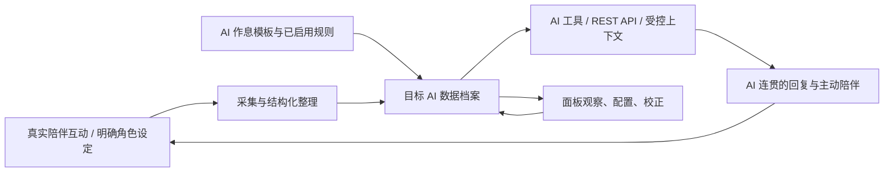

# AI 陪伴工作台：产品定位与设计依据

本说明依据用户在 2026-10-18 的明确定位：**“相当于 AI 工作台，记录 AI 的陪伴，方便 AI 基于这些数据拟人而已。”** 这是后续设计的入口，功能现状以源码为准；本轮检查与修复状态见 [FILE_REVIEW.md](FILE_REVIEW.md)。

## 1. 工作台服务谁

工作台服务 AI 的连续陪伴表现。它保存 AI 自身的状态、安排、记住的事情和双方互动经历，使 AI 在后续对话中有依据地表达“我现在怎么样”“我记得我们之前聊过什么”“我还惦记着你的那件事”。

用户通过面板观察 AI、配置规则、检查来源和校正结果。面板的存在是为了管理这份 AI 档案；不以要求用户每天登记个人心情、健康、日程或生活流水为核心。

拟人表现来自明确的人设、状态与上下文连续性。新增字段、表单、图表或页签，只有在帮助形成、读取或理解这条链路时才有价值。

## 2. 每类数据的主体和用途

| 数据 | 主体与含义 | 给 AI 的用途 | 设计边界 |
|---|---|---|---|
| `state` | AI 的心情、精力、睡眠、饥饿等拟人状态 | 表达当前状态，保持前后连贯 | 不将用户“我失眠了”直接写成 AI 睡眠；人工编辑是校正 AI 档案 |
| `schedule` / `routine` | AI 的当日活动计划与作息模板 | 让 AI 的活动、清醒与精力变化有依据 | 计划不等于已发生；没有证据不能说某件活动已经完成 |
| `dreams` | AI 讲述或明确创作的梦境 | 提供角色表达和互动素材 | 创作保留标识，不能变成用户或 AI 的真实历史事实 |
| `notes` | AI 记住的叮嘱、约定、待关心的事项 | 回应承诺、适时关怀 | 可包含用户考试等信息，但它仍是 AI 记住的事项；记录成功不等于提醒送达 |
| `relationship` / `milestones` | AI 与用户的关系和已确认互动 | 维持共同经历与称呼、语气的连续性 | 分数是可解释的产品刻度；不把关系评价交给不受约束的模型猜测 |
| `important_dates` | AI、用户或双方相关的重要日期 | 记住并回应特定日期 | 保留日期所属对象；用户生日不能变成 AI 生日 |
| `history` | AI 状态与日程的历史快照 | 支持回顾、解释变化和检查连续性 | 当前实现保留每日快照，不是一天内所有变化的事件流 |
| 插件 `diary/`、`weekly/` | AI 对自身状态和陪伴经历的叙事整理 | 为后续回顾与表达提供材料 | 写入文件不等于主对话已经读取；不能将用户自述改写成 AI 自述 |
| 宿主 `memory/YYYY-MM-DD.md` | 宿主工作区已有的日记/记忆 | 为 AI 提供既有经历来源 | 来源取决于宿主；当前“那一天”读取这里，与插件日记分开 |
| `profiles.json` | AI 到陪伴数据档案的映射 | 将调用定位到独立或共用档案 | `shared` 是共用，不自动意味着“当前 AI 独有” |
| 互动与用量统计 | 工具调用、关怀投递、模型请求的计数 | 解释关系候选与运行成本 | 调用次数不等于对话次数，投递成功不等于已读 |

## 3. 核心闭环及当前实现

| 阶段 | 已有代码 | 当前实际边界 |
|---|---|---|
| 从对话积累 | `organizer.py` | 读取近期 user/assistant 文字，按六个模块整理；手动预览确认或显式开启自动整理 |
| 从既有记忆补充 | `file_backfill.py`、`companion_features.py` | 受限读取、脱敏、审阅，再回填允许的资料；不是自动读取整个工作区 |
| 形成 AI 状态 | `plugin.py`、`life.py`、`plan.py` | 保存字段、按作息惰性演化、规划草案；规则引擎目前只演化 sleep/hunger/energy |
| 保存与隔离 | `plugin.py` 的 `_ProfilePath`、`_profile_from_request` | 按档案读写；查询参数、工具执行上下文、钩子上下文均参与，各入口独立进入并恢复档案，预览应用校验目标 |
| AI 回读 | `plugin.py` 的七个工具、`_build_prompt`、`SKILL.md` | 五个读取工具加状态更新、便签创建；提示提供受限的 AI 状态、作息与插件叙事摘要；保留工具按需读取 |
| 主动陪伴 | `care.py` | 显式启用后使用宿主调度、首见上下文与渠道接口；不由工作台另开后台服务 |
| 日记与回顾 | `diary.py`、`weekly.py`、`companion_features.py` | 插件日记与宿主日记保留来源，回顾聚合展示；状态工具和提示提供插件叙事摘要 |
| 人工观察 | `ui/index.js` | 查看数据、配置、审阅、校正、检查和备份；不应成为记录用户生活的主入口 |

**不能推导的结论：** 工具注册不代表模型会选用；系统提示存在不代表 AI 读过日记；面板有数据不代表 AI 正确理解；单次演化不等于持续后台生活循环；模型提示中的主体规则也不保证所有模型都会遵守。

## 4. 下一次设计先回答的问题

每个改动写清以下六点，再考虑视觉和操作：

1. **属于哪个 AI？** 执行智能体、聊天来源、目标档案和投递对象分别是什么？共用档案如何说明？
2. **怎么形成？** 来自真实互动、用户明确给 AI 的设定、规则推导、未来计划，还是创作？
3. **怎么保存？** 哪个文件、日期和标识？有无旧数据兼容、冲突检查、去重与回退？
4. **怎么回读？** 哪个工具、何时调用、返回哪些上下文？已有技能复制到工作区后如何更新？
5. **如何影响陪伴？** 预期改变 AI 的哪句话、哪个行为？如何保持原有人设，不机械报数？
6. **怎么验证？** 数据生成、落盘、跨日/重启、AI 实际读取、最终表达与模型调用预算分别如何验收？

## 5. 必须保留的设计决定

- 用户已修复并认可导航与自定义折叠。没有新要求时不重组导航，也不把导航数量当成主要问题。
- 自动功能默认关闭；用户显式开启之后，按已选择的自动策略运行。人工预览确认与已授权自动写入分别设计。
- 拟人状态是角色状态，允许明确设定和可解释规则演化；历史互动事实、未来计划、创作梦境、模型推断分别管理。
- 空白表示未记录。无需为了面板好看补默认心情、关系分数、经历或“第一次”。
- 用户资料可以被 AI 记住，但经历归属不能丢失。人设风格、文件修改时间和模型猜测都不是实际互动证据。
- 保存前预览应绑定目标档案及输入版本，应用时重新检查；切换 AI 不能把上一 AI 的候选写进新档案。
- 面板操作优先展示“AI 当前记录、来源、最近整理/读取、为什么变化、需要校正哪里”，不要再默认增加用户个人打卡表单。
- 保留宿主原有人设；沿用宿主模型、工具、调度与生命周期能力，避免新增高负载常驻进程。

## 6. 后续工作的顺序

1. 2.14.0 已修复 [检查报告](FILE_REVIEW.md) 的档案归属、预览绑定、工具/API 不一致与自动日记状态问题，先在测试环境验收。
2. 验证已加入的插件日记/宿主来源区分与受限摘要，观察其是否真正影响 AI 的下一次对话。
3. 根据真实模型使用摘要的结果，再决定是否增加专门工具或更细的上下文检索。
4. 最后改进面板对上述链路的可见性，不通过增加填写入口替代数据闭环。

这一顺序用于测试环境验收与后续优化；源码修复状态见报告，不授权直接改动已安装实例。

## 7. 下一轮验收场景

- AI 问候后形成属于它自己的情绪变化，下一次回复可通过明确读取引用同一档案。
- 用户说“我今天很累”，AI 可以记住并关心用户；AI 自己的精力不得因此直接等同于用户疲劳。
- 跨日后，AI 工具与面板读取到同一作息；日程中午休、饭点驱动 AI 拟人状态的结果一致。
- A 的日记或整理预览在 B 档案下应用应被拒绝；数据来源 A 与目标 B 的操作必须显式说明。
- 插件新生成的日记在相应回顾入口可找到；再验证 AI 确实读取过它，而不只检查文件存在。
- 保存失败保留候选；调度失败显示真实关闭/失败状态；重启后记录和配置仍可追溯。
- 新的陪伴记录有明确的备份恢复范围；用户手动更新前能备份整个实际数据目录。

## 8. 文件与验证入口

完整文件职责清单和问题证据在 [FILE_REVIEW.md](FILE_REVIEW.md)。`AGENTS.md` 给代码维护代理读，`SKILL.md` 给运行中的陪伴 AI 读。

开发文档、历史设计和审查报告保留在仓库。安装包由 `scripts/package.py` 白名单生成；不要为描述产品定位而把开发临时文件或审查数据打进包。源码检查、离线测试、浏览器替身和真实宿主测试各自陈述结果，不能互相替代。
